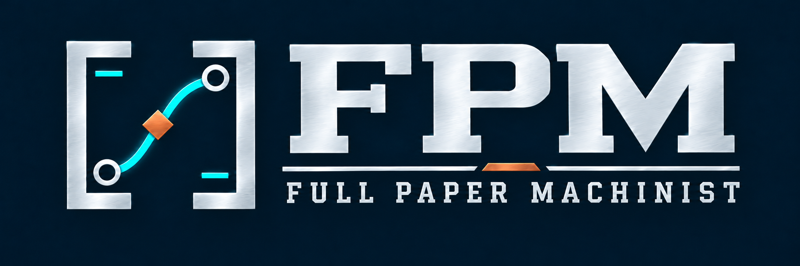

# Full Paper Machinist (FPM)

**Uma ponte entre suas ideias de pesquisa e as ferramentas de IA.**

[English](README.md) · [Comece aqui](GET_STARTED.md) · [Início da conversa](starter/START.pt-BR.md) · [Exemplo Ising 2D](examples/ising2d/README.pt-BR.md) · [Método](docs/METHOD.pt-BR.md) · [Limites](docs/LIMITATIONS.md)

Uma ideia científica nem sempre nasce como uma pergunta formalizada. O **FPM Research Companion** ajuda o pesquisador a conversar sobre o que deseja compreender, encontrar hipóteses e caminhos plausíveis, escolher métodos e ferramentas apropriados e transformar a direção escolhida em uma investigação realizável. **O pesquisador continua responsável pelas decisões científicas.**

A contribuição pretendida não é um algoritmo científico mais autônomo, mas uma **interface de tradução e orientação**, especialmente útil a quem não conhece agentes, prompts ou fluxos de IA. A eficácia dessa abordagem ainda não foi medida independentemente.

## Experimente agora — sem instalar software

1. Abra [o início em português](starter/START.pt-BR.md). No GitHub, use **Raw** para copiar **o arquivo inteiro** e colar em uma conversa nova com uma IA (ou copie todo o texto do arquivo no ZIP).
2. Conte sua ideia com suas palavras, por exemplo: *“Tenho curiosidade sobre fenômenos coletivos e transições de fase, mas não sei como começar uma pesquisa.”*
3. Discuta a primeira direção proposta; peça explicações, alternativas ou um plano, conforme seu interesse. Você não precisa completar formulário nem baixar o exemplo de física.
4. Se quiser continuar outra hora, peça um **resumo recuperável**. O modelo opcional está em [NOTEBOOK](starter/NOTEBOOK.md).

O Companion é constituído de instruções abertas em Markdown, não é um modelo ou aplicativo instalado. A disponibilidade de busca bibliográfica, leitura de arquivos, Python ou outros recursos **depende do assistente e da sessão**. Uma proposta de execução não é resultado executado.

## Como a mediação científica funciona

O Companion incorpora **princípios metodológicos gerais já ratificados** no FPM interno: verificar comparabilidade antes de combinar conjuntos de dados, distinguir execução de validação independente, recuperar resultados antes de recomputar e preservar o sentido das afirmações de um manuscrito. Aplica essas lições **quando pertinentes**, sem transformar a conversa em um procedimento obrigatório. Veja o [método](docs/METHOD.pt-BR.md) e [dois percursos interdisciplinares ilustrativos](examples/RESEARCH_PATHS.pt-BR.md). Os exemplos são editoriais, não testes com usuários.

## Conheça um exemplo científico

O [laboratório Ising 2D](examples/ising2d/README.pt-BR.md) mostra como passar da curiosidade sobre ordem magnética para escolhas de modelo, observáveis e código Monte Carlo reproduzível. É **opcional** para usar o Companion. O exemplo traz código próprio, testes elementares e dados exploratórios; não reivindica uma estimativa precisa da temperatura crítica.

O artigo *Quarantine Games on Networks* utiliza uma investigação computacional muito mais longa. Seu [repositório científico separado](https://github.com/AmaralMA42/quarantine_games_network) contém o código e os dados publicados de reprodução. O FPM não copia esses materiais nem reivindica uma avaliação independente de seus agentes a partir desse caso.

## Se você já tem experiência

Comece diretamente com seu problema técnico, desenho ou dados. O Companion deve dispensar explicações elementares desnecessárias e ajudar a comparar observáveis, limitações, incerteza e ferramentas disponíveis.

## O que o FPM ainda não é

Não é um cientista autônomo certificado, uma garantia de originalidade ou validade, um serviço de computação, um meio de recuperar fontes inacessíveis nem substituto de pareceres independentes. [Método](docs/METHOD.pt-BR.md), [arquitetura](docs/ARCHITECTURE.md), [limitações](docs/LIMITATIONS.md) e [roadmap](docs/ROADMAP.md) descrevem os limites e próximos componentes.

Copyright © 2026 Marco Antonio Amaral. Os materiais originais desta versão FPM Research Companion v0.2.0 são distribuídos sob a licença [GNU GPL v3.0 somente](LICENSE) (`GPL-3.0-only`). Bibliotecas e serviços externos, assim como o projeto Quarantine Games vinculado, mantêm suas próprias licenças aplicáveis. Os metadados para citação estão em [`CITATION.cff`](CITATION.cff). Evite divulgar materiais confidenciais em issues públicas ou serviços de IA sem verificar sua política de privacidade.
